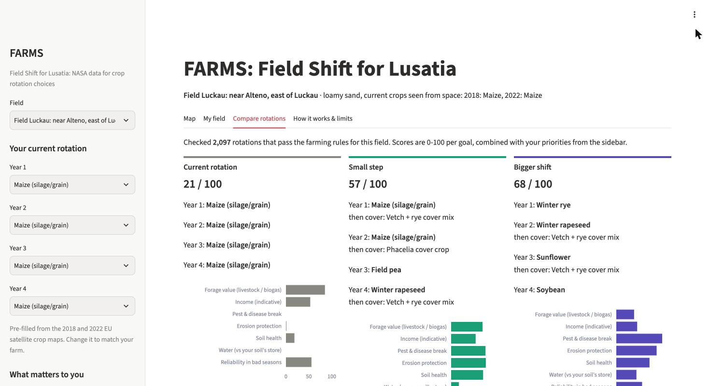
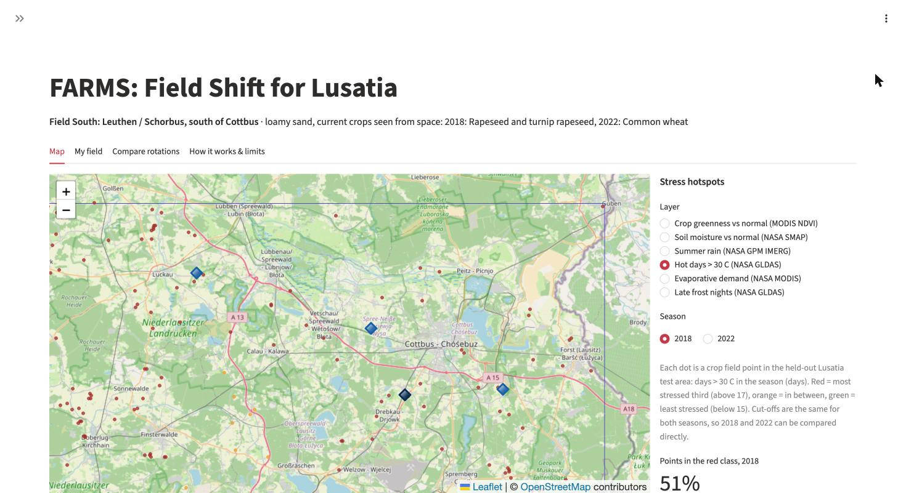
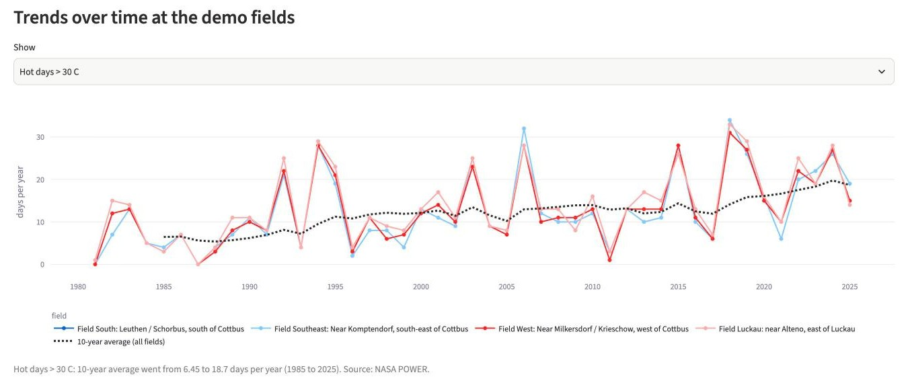
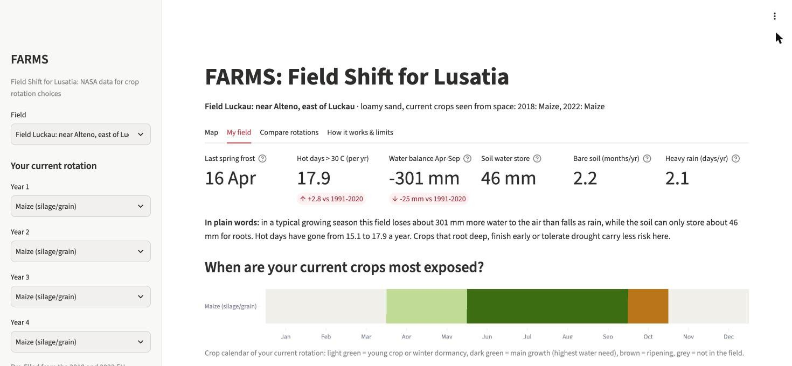
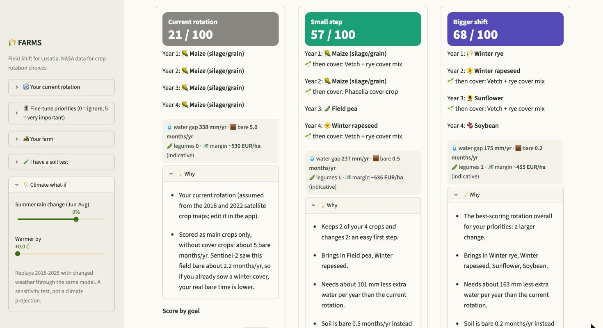
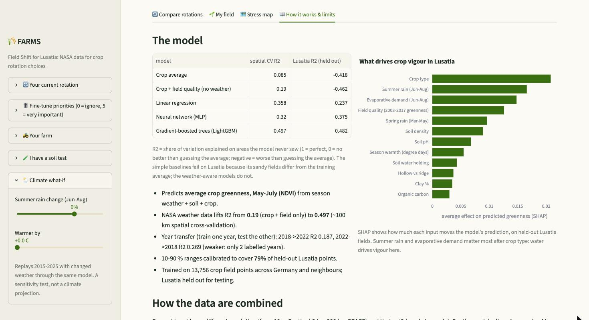
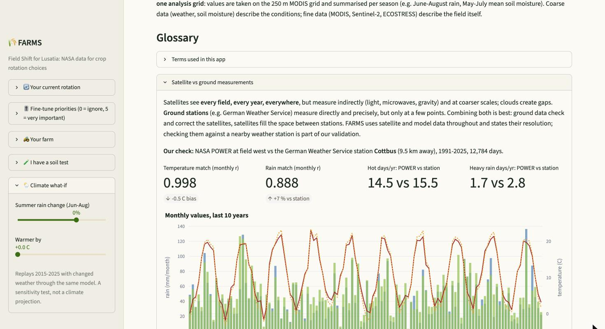

# FARMS: Field Shift for Lusatia
#### Try it live: https://field-shift-nasa-spaceapps-2026.streamlit.app (first load may take ~30 s if the app was asleep) /n
**NASA satellite data turned into crop-rotation choices a farmer can check, weigh and question.**

Team FARMS · NASA Space Apps Challenge 2026 · Challenge: *Field Shift: Adapting Farms with NASA Data* · Local event: Cottbus, Germany



Farms in Lusatia (Brandenburg, eastern Germany) sit on sandy soils that hold little water, and summers are getting hotter and drier. FARMS compares a farm's **current crop rotation** with two alternatives, a **small step** (at most two crops changed) and a **bigger shift**, using NASA Earth observations, soil data, EU satellite crop maps and the farmer's own priorities. For every rotation it explains **why** it was suggested, the **evidence**, the **benefits**, the **information gaps** and the **risks** to check locally.

FARMS supports the farmer's judgement. It does not replace it.

---

## What the app shows

| Tab | What you get |
| --- | --- |
| **Map** | Stress hotspots across 1,254 held-out Lusatia crop fields for 2018 and 2022: crop greenness, soil moisture, summer rain, hot days, evaporative demand, late frost. Below: trends since 1981 at the demo fields (heat, water balance, rain, dry spells, heavy rain, frost dates, soil moisture, surface temperature, GRACE water storage). |
| **My field** | Six plain-word cards (last spring frost, hot days, water balance, soil water store, bare-soil months, heavy rain), a crop calendar showing when current crops are most exposed, and the charts behind each number. |
| **Compare rotations** | Current rotation vs small step vs bigger shift: score 0-100, seven goal bars, and Why / Evidence / Benefits / Information gaps / Risks / Check locally. A replay shows how each rotation would have done in the real weather of 2015-2025. |
| **How it works & limits** | Model comparison, SHAP drivers, how datasets are combined, glossary, satellite vs ground-station check, how crop types help soil health, all data sources, limitations. |

The farmer sets **seven priorities** (reliability in bad seasons, water, soil health, erosion, pest & disease break, income, forage value), **constraints** (can irrigate, livestock or biogas, niche markets, crops they cannot grow), an optional **soil test**, and a **climate what-if** (summer rain change, warming).

### Stress hotspots: hot days in 2018


### Hot days above 30 C at the demo fields, 1981-2025
The 10-year average rose from about 6.5 to 18.7 days per year (NASA POWER).


### My field: Field Luckau


### Why each rotation was suggested


---

## Key results

| Check | Result |
| --- | --- |
| Model accuracy, spatial cross-validation (~100 km blocks) | R² 0.497 (LightGBM); crop + field only, no weather: 0.19 |
| Model on the held-out Lusatia test area | R² 0.482 |
| 10-90 % uncertainty ranges after calibration | cover 79 % of real outcomes (target 80 %) |
| NASA POWER vs German Weather Service, Cottbus, 1991-2025 | temperature r 0.998 (bias -0.5 C); monthly rain r 0.888 (+7 %) |
| Heavy-rain days ≥ 20 mm, POWER vs station | 1.7 vs 2.8 per year: downpours are undercounted (stated in the app) |

**Example, Field Luckau** (maize every year on loamy sand that stores only 46 mm of water):

| Rotation | Score | Water deficit (mm/yr) | Bare soil (months/yr) |
| --- | --- | --- | --- |
| Current: maize ×4 | 21 | 338 | 5.0 |
| Small step: maize, maize, field pea, rapeseed + cover crops | 57 | 237 | 0.5 |
| Bigger shift: rye, rapeseed, sunflower, soybean + cover crops | 68 | 175 | 0.2 |





---

## Data

| Source | Used for |
| --- | --- |
| **NASA POWER** (daily, 1981-2026, ~50 km) | frost, heat, FAO-56 reference ET, water balance, dry spells, heavy rain, trends |
| **NASA SMAP L4** (root-zone soil moisture, 9 km) | model input, soil-moisture map and trend |
| **NASA GPM IMERG** (monthly rain, ~11 km) | model input, summer-rain map |
| **NASA MODIS** MOD13Q1 NDVI, MOD16A2GF ET/PET, MOD11A2 LST | model target (crop greenness), evaporative demand, surface temperature, common 250 m grid |
| **NASA ECOSTRESS** (via AppEEARS, 70 m) | field-level summer water stress (optional) |
| **NASA GRACE / GRACE-FO** (JPL mascons) | regional water-storage trend |
| **NASA GLDAS Noah 2.1** (3-hourly temperature) | hot days, late frost, degree days |
| **NASA SRTM** (30 m) | slope, terrain position |
| **ESA Sentinel-2 L2A** (10 m) | bare-soil months per field |
| **JRC EUCROPMAP** 2018, 2022 | training labels, current rotation |
| **ISRIC SoilGrids 2.0** (250 m) | sand, clay, organic carbon, pH, density |
| **DWD Climate Data Center** (Cottbus station, CC BY 4.0) | ground check of NASA POWER |

Methods: FAO-56 Penman-Monteith (Allen et al. 1998), soil water holding after Saxton & Rawls (2006), LightGBM (Ke et al. 2017), SHAP (Lundberg & Lee 2017), split-conformal calibration. Crop characteristics and their sources are in `data/crops.json`.

---

## Quick start: run the app

The repository includes the processed data and the trained model, so the app runs **without** any Earth Engine or NASA login.

```bash
git clone https://github.com/<your-username>/FARMS.git
cd FARMS
python -m venv .venv
source .venv/bin/activate          # Windows: .venv\Scripts\activate
pip install -r requirements.txt
python -m streamlit run app/app.py
```

Then open http://localhost:8501 and pick a field in the sidebar.

---

## Rebuild everything from raw data

You need a Google Earth Engine project (set `GEE_PROJECT` in `src/config.py`, then run `earthengine authenticate`). An Earthdata login is needed only for the optional ECOSTRESS step. Run from the `FARMS` folder; `src/validate.py --step N` checks each step.

| Step | Command | What it does |
| --- | --- | --- |
| 1 | `python src/extract_gee.py` | SMAP, IMERG, MODIS, GRACE, SRTM, SoilGrids, EUCROPMAP for the fields |
| 1b | `python src/extract_s2.py` | Sentinel-2 bare-soil months |
| 2 | `python src/extract_power.py` | NASA POWER daily weather since 1981 |
| 3 (optional) | `python src/appeears.py submit` → `status` → `download`, then `python src/load_ecostress.py` | ECOSTRESS via AppEEARS (uses `EARTHDATA_USER` / `EARTHDATA_PASS` environment variables) |
| 4 | `python src/extract_training.py --only test`, `--only train`, `--only demo` | training sample (Germany + neighbours), held-out Lusatia test set, demo season features |
| 5 | `python src/features.py` | field profiles (frost, heat, ET0, water balance, soil, bare soil, ...) |
| 6 | `python src/train_model.py` | compares 5 models, trains LightGBM, SHAP, calibrated ranges |
| 7 | `python src/predict.py` then `python src/rotations.py` | 2015-2025 replay and rotation strategies |
| 8 | `python src/validate.py --step 8` | headless app test |
| 9 | `python src/dwd_check.py` | NASA POWER vs DWD Cottbus station |

### Add your own field (one command)

```bash
python src/add_field.py --id my_field --lat 51.85 --lon 13.79 --label "near Luckau"
```

This runs the whole pipeline for the new point (no retraining) and adds it to the app's field list. Check on satellite imagery that the point is inside a crop field. Fields outside Germany and its neighbours are marked as extrapolation. Remove one with `--remove my_field`.

---

## Project structure

```
FARMS/
├── app/app.py              Streamlit app
├── src/                    pipeline scripts (see table above), config.py, validate.py
├── data/crops.json         crop table: water use, roots, tolerances, prices, forage value, sources
├── data/fields_extra.json  fields added with add_field.py
├── data/processed/         field profiles, predictions, rotations, model report, station check
├── models/                 trained model
├── docs/screenshots/       images used in this README
├── PROJECT.md              goals, decisions and validation checkpoints
└── requirements.txt
```

`data/raw/` (downloads) is not in the repository; the extract scripts recreate it.

---

## Limitations

- Only two years of crop labels (2018, 2022); year-to-year accuracy is moderate (R² about 0.2-0.3).
- NDVI greenness is a proxy for crop vigour, not yield.
- Weather data are coarse (NASA POWER ~50 km, GRACE ~300 km); nearby fields share one weather cell.
- Each field is a point, so differences inside one field are not shown yet.
- Soil values are modelled (SoilGrids 250 m) unless the farmer enters a soil test.
- Prices, yields, crop tolerances and forage values are indicative or expert judgement.

**Next steps:** field outlines with 10 m zones, more years of crop labels, and testing with farmers and the Brandenburg advisory service (LELF).

---

## Use of AI

The crop-vigour model (LightGBM with SHAP explanations and calibrated uncertainty) is part of the tool. We also used Claude (Anthropic) as a coding and writing assistant to plan the pipeline, write and debug code, test the app and draft documentation. All numbers come from our own code runs on real NASA and partner data and were checked with automated validation steps.

## Team

Vansh Sethi (team FARMS)
